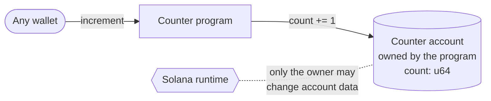

# Counter

**Basics, 3 of 14.** Previous: [Account Data](../account-data). Next: [Favorites](../favorites).

A Solana program keeps nothing in memory between calls. Anything it needs to remember has to
live in an account. This example keeps one number, a `u64`, in an account the program owns, and
adds one to it every time someone sends `increment`.

That is the whole program. What makes it worth reading is what it does **not** do: it never asks
who is calling, and in two of the three versions it never checks whose account it was handed.
Both are safe here, for different reasons, and both are worth understanding before you copy this
shape into a program that matters.

## The picture



The counter is an ordinary account. The program does not hold it; the program **owns** it, which
means the runtime lets this program, and no other, change its bytes.

What those bytes look like depends on the version:

| Version | Bytes 0–7 | Bytes 8–15 | Size |
| --- | --- | --- | --- |
| Anchor | discriminator, the first 8 bytes of `sha256("account:Counter")` | `count`, little-endian `u64` | 16 |
| Native | `count`, little-endian `u64` | | 8 |
| Pinocchio | `count`, little-endian `u64` | | 8 |

Little-endian means the lowest byte comes first: after one increment byte 8 (Anchor) or byte 0
(native, Pinocchio) is `01`, and the rest stay `00`. Bytes are written in hexadecimal, so after
`09` comes `0a`.

## Three versions, one program

|  | Creating the counter | `increment` |
| --- | --- | --- |
| [Anchor](./anchor/programs/counter_anchor/src/lib.rs) | Its own instruction, `initialize_counter`. The `init` constraint creates the account, sized `8 + Counter::INIT_SPACE`, paid for by `payer` | Adds 1 with `checked_add(1)` on the typed account |
| [Native](./native/program/src/lib.rs) | No instruction. The client creates an 8-byte account owned by the program with the System Program, then calls `increment` | Instruction byte `0`. Borsh-decodes the account, adds 1, writes it back |
| [Pinocchio](./pinocchio/program/src/lib.rs) | Same as native | Instruction byte `0`. Reads bytes 0–7 as a `u64`, adds 1, writes the 8 bytes back. No serialization library |

Read them in that order. Anchor hides the most, Pinocchio the least: by the end you have seen
every byte that Anchor was writing for you.

## Who can do what

**Anyone can increment any counter.** `increment` takes one account, the counter, and no signer.
The wallet paying the fee is not passed to the program at all, so the program cannot tell who
called it. That is fine for a demo and wrong for almost anything real:
[Favorites](../favorites), next, ties each account to a user.

**Nobody can increment a counter the program does not own, but the check happens in different
places.**

- **Anchor** checks before your code runs. `Account<'info, Counter>` verifies that the account is
  owned by this program and starts with the `Counter` discriminator. Hand it anything else and the
  instruction fails with `AccountOwnedByWrongProgram` (error 3007), or `AccountNotInitialized`
  (3012) for an address with no account.
- **Native and Pinocchio** do not check the owner at all. They read the bytes, add one, and write
  them back. The **runtime** catches it afterwards: a program may only change the data of accounts
  it owns, so the transaction fails with `ExternalAccountDataModified` and the write is rolled
  back.

The second is a backstop, not a design. It holds here because writing is the only thing the
program does with the account. A program that **reads** an account it never checked, say a price
or a balance, gets no such protection. Missing account checks are one of the most common ways
Solana programs get exploited, and [Checking Accounts](../checking-accounts) covers it.

**Two more things to know before you copy the native or Pinocchio version:**

- An unknown instruction byte succeeds. Any byte other than `0` logs `Error: unknown instruction`
  and returns `Ok(())`, so the transaction lands and nothing happens. A real program should return
  an error.
- Empty instruction data panics. `instruction_data.split_at(1)` aborts when there is no first
  byte. The transaction fails, which is the right outcome, but as `ProgramFailedToComplete`
  instead of an error a client can act on.

## What the tests check

Each version has TypeScript tests in [LiteSVM](https://github.com/LiteSVM/litesvm), which runs the
compiled program in-process with no validator, and the native and Pinocchio versions also have a
Rust test.

- **Anchor** (`anchor/tests/litesvm.test.ts`): creates a counter, increments it twice, and reads
  0, 1, 2. It does not check each transaction's result, so a failed call only shows up as a wrong
  count afterwards.
- **Native and Pinocchio** (`tests/counter.test.ts`, `program/tests/test.rs`): create the account,
  increment, read 1, and check every transaction's result.

None of them covers the interesting cases above: that any wallet can increment, or what happens
with an account the program does not own. Try those yourself: they are the lesson.

## Run it

You need the [Solana CLI](https://solana.com/docs/intro/installation), Rust, Node and pnpm.

```shell
# Anchor
cd anchor && pnpm install && anchor test

# Native or Pinocchio
cd native && pnpm install && pnpm build-and-test
```
