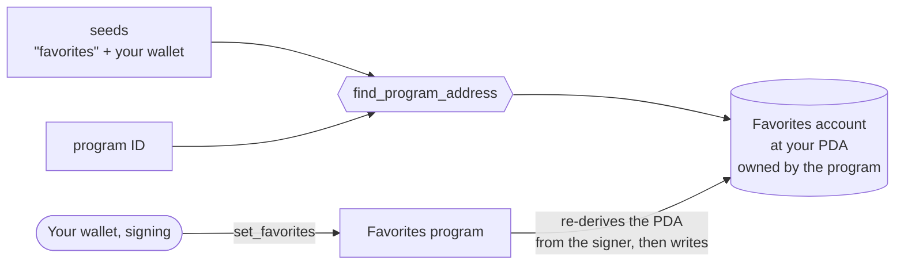

# Favorites

**Basics, 4 of 14.** Previous: [Counter](../counter). Next: [Checking Accounts](../checking-accounts).

[Counter](../counter) let anyone change any counter. Favorites fixes that: every user gets their
own account, at an address worked out from their wallet, and only they can write to it. It stores
a favorite number, a color and a few hobbies.

Two ideas carry the example: the **program derived address** (PDA), an address computed from
seeds instead of a keypair, and the **signer**, which ties that address to the person calling.

## The picture



A PDA has no private key. Anyone can compute it from the seeds and the program ID, so your wallet
never has to store it, and the client and the program always find the same account. The **bump**
is one extra seed byte that pushes the address off the ed25519 curve, which is what guarantees
no private key exists for it; `find_program_address` returns the first bump, counting down from
255, that does.

## Who can change what

The program re-derives the address from **the account that signed** and compares it with the
account it was handed. So:

- You can write to your own favorites: you sign, and the address derived from your key matches.
- You cannot write to someone else's: you can pass their account, but the address derived from
  your key does not match it, and the program refuses.
- Nobody can write to yours without your signature, because the transaction is only valid with
  it.

The three versions refuse in different words:

| Version | Wrong account passed | Error |
| --- | --- | --- |
| Anchor | the `seeds` constraint fails before the instruction runs | `ConstraintSeeds` (2006) |
| Native | the program compares the addresses itself | `IncorrectProgramId` (a misleading name for "wrong address") |
| Pinocchio | same comparison | `IncorrectProgramId` |

## Three versions, three different programs

They share the idea and differ in almost everything else, which is worth noticing before you
copy one:

|  | [Anchor](./anchor/programs/favorites/src/lib.rs) | [Native](./native/program/src/) | [Pinocchio](./pinocchio/program/src/) |
| --- | --- | --- | --- |
| Seeds | `"favorites"` + user | `"favorite"` + user | `"favorite"` + user + bump from the client |
| Instructions | `set_favorites` | `CreatePda` (0), `GetPda` (1) | create (1), get (2) |
| Update existing favorites | yes: `init_if_needed` creates the first time and overwrites after | no: a second call fails with `AccountAlreadyInitialized` | no: same |
| Account size | 344 bytes, fixed by `max_len` | exactly the first data saved | 80 bytes, fixed |
| Text | length-prefixed, any length | length-prefixed, any length | color 8 bytes, 4 hobbies of 16 bytes |
| Reading back | the client decodes the account | `GetPda` logs it | get logs it |

The seeds differ, so the same wallet gets a different address in the Anchor version than in the
other two.

## The bytes (Anchor)

```
0         8          16      20          20+n    24+n    28+n
| tag (8) | number u64 | len n | color (n bytes) | count | len | hobby | len | hobby | …zeros
```

| Field | Bytes | Stored as |
| --- | --- | --- |
| discriminator | 8 | first 8 bytes of `sha256("account:Favorites")` |
| `number` | 8 | `u64`, little-endian |
| `color` | 4 + up to 50 | a `u32` length, then the UTF-8 bytes |
| `hobbies` | 4 + up to 5 × (4 + 50) | a `u32` count, then each hobby as length + bytes |
| total | **344** | `8 + Favorites::INIT_SPACE` |

Native uses the same encoding (Borsh) without the discriminator and without spare room.
Pinocchio uses no encoding at all: `number` in bytes 0–7, `color` in 8–15, then four 16-byte
hobby slots, written exactly as the client sent them.

## Things to know before you copy it

- **`max_len` is not a limit.** In the Anchor version, `#[max_len(50)]` only sizes the account.
  Nothing checks it: a 60- or even 300-character color is stored, in the space meant for hobbies.
  What finally stops it is the account's size: data longer than 344 bytes fails with
  `AccountDidNotSerialize` (3004). If a length matters, check it in the instruction.
- **Shorter data does not erase longer data.** `set_inner` writes from the start of the account
  and never clears the rest. Save "blue" with two hobbies, then "green" with none, and the old
  hobby bytes are still in the account after the new data. Nothing reads them, because readers
  follow the lengths, but they are there.
- **Pinocchio takes the bump from the client.** It calls `create_program_address` with whatever
  bump the client sends and never checks it is the canonical one, the bump
  `find_program_address` would return. Any other bump that produces a valid PDA is accepted too,
  so in principle one wallet can create more than one favorites account. The usual fix is to
  derive with `find_program_address`, or to store the canonical bump and compare.
- **Native and Pinocchio cannot update.** They only create; changing your favorites needs a new
  instruction.

## What the tests check

- **Anchor** (`anchor/tests/litesvm.test.ts`): saves favorites and reads them back, then updates
  them. The third test, "Rejects transactions from unauthorized signers", signs with a key that
  is not in the transaction, so `@solana/web3.js` throws `unknown signer` before anything is sent:
  it never reaches the program, and passes whatever the program does.
- **Native** (`tests/test.ts`, `program/tests/test.rs`): creates the favorites, checks a PDA
  derived from the wrong seeds is rejected by the program, and reads the favorites back with
  `GetPda`.
- **Pinocchio** (`tests/test.ts`, `program/tests/test.rs`): creates the favorites and reads them
  back.

None of them tries writing into someone else's account, which is the case the example exists
for.

## Run it

```shell
# Anchor
cd anchor && pnpm install && anchor test

# Native or Pinocchio
cd native && pnpm install && pnpm build-and-test
```
